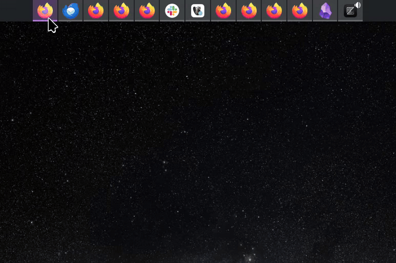

# Maximalist Task Manager

An icons-only task manager widget for KDE Plasma 6 that lets you change the icon of individual windows.

When several windows of the same app are open, e.g. one Firefox window per project, they all share one icon and are hard to tell apart. Right-click a window in the task manager, pick **Change Icon**, and give that window its own icon.

It is a fork of Plasma's own Icons-Only Task Manager, so everything else looks and behaves exactly like the stock widget. The feature was [proposed upstream](https://invent.kde.org/plasma/plasma-desktop/-/merge_requests/4157) and declined, so it lives here instead.

## Features

- **Change Icon** in the task context menu:
  - pick an icon from the app's suggested alternatives or your presets
  - **Choose…** any icon through the standard icon picker
  - **Reset to Default**

  

- **Cycle Icon of Active Window** global shortcut: steps the focused window through the same icons the menu offers, then back to the default. It is unbound by default; assign it in System Settings → Keyboard → Shortcuts → Plasma Workspace.
- Only the task manager is affected. Grouping, launchers and the window's app identity stay the same, and the titlebar and Alt+Tab keep the app's normal icon.
- Overrides belong to a window and are forgotten once it closes, so nothing is left behind after restarts.

### Suggesting icons for an app

Add an `X-KDE-TaskManager-AlternativeIcons` key to the app's `.desktop` file (a local copy in `~/.local/share/applications/` works) with a list of icon names or absolute paths:

```ini
X-KDE-TaskManager-AlternativeIcons=firefox-developer-edition;firefox-nightly;/home/me/icons/travel.svg;
```

Apps without the key fall back to the widget-wide `iconOverridePresets` setting, which is empty by default.

## Compatibility

The widget is built from the Plasma **6.8.1** sources and uses private Plasma QML modules, the same ones the stock task manager uses. It is only expected to work on Plasma 6.8. A matching release follows each Plasma minor version.

## Installing

### NixOS

Add the flake as an input and its package to your system:

```nix
{
  inputs.maximalist-task-manager = {
    url = "github:granitosaurus/plasma-maximalist-task-manager";
    inputs.nixpkgs.follows = "nixpkgs";
  };

  # in your NixOS configuration
  environment.systemPackages = [
    inputs.maximalist-task-manager.packages.${pkgs.stdenv.hostPlatform.system}.default
  ];
}
```

### From source

Requires the development packages for Qt 6, KDE Frameworks 6, libplasma, plasma-activities(-stats), plasma-workspace (LibNotificationManager) and libksysguard.

```sh
cmake -B build -DCMAKE_INSTALL_PREFIX=/usr
cmake --build build
sudo cmake --install build
```

Then restart Plasma (`systemctl --user restart plasma-plasmashell`), right-click your current task manager, choose **Show Alternatives…** and pick **Maximalist Task Manager**.

## Maintaining the fork

The first commit is an unmodified import of `applets/taskmanager` from plasma-desktop v6.8.1. The second commit makes it a standalone widget, and the commits after that add features. To move to a new Plasma release, apply the upstream changes to the applet with the plugin id renamed:

```sh
git -C ../plasma-desktop diff v6.8.1 v6.9.0 --relative=applets/taskmanager \
  | sed -e 's/org\.kde\.plasma\.taskmanager/com.github.granitosaurus.maximalisttaskmanager/g' \
        -e 's/org\.kde\.plasma\.icontasks/com.github.granitosaurus.maximalisttaskmanager/g' \
  | git apply --reject --directory=src
```

Then fix any `*.rej` files, bump `PLASMA_BASE_VERSION` in `CMakeLists.txt`, and refresh `po/` from the new release.

## License

GPL-2.0-or-later, like the upstream task manager. Original code by Eike Hein and the KDE community.
